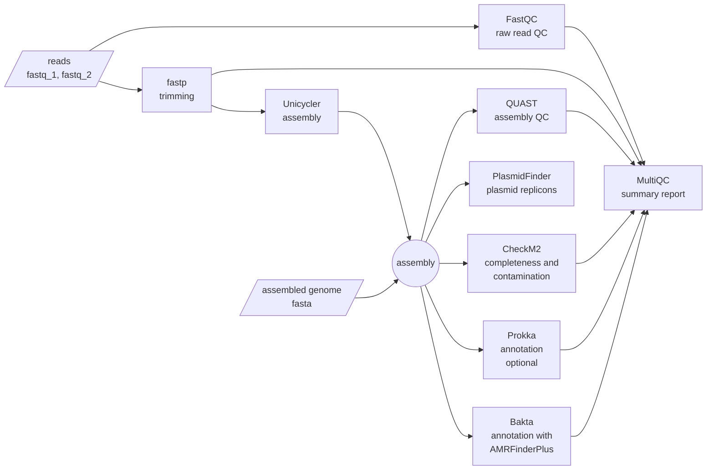

<h1 align="center">AMRBench_QC</h1>

<p align="center">
  Read QC, assembly, quality assessment and annotation for bacterial genomes
</p>

<p align="center">
  <a href="https://www.nextflow.io/"></a>
  <a href="https://www.docker.com/"></a>
  <a href="https://sylabs.io/docs/"></a>
  <a href="https://docs.conda.io/en/latest/"></a>
</p>

<p align="center">
  <sub>Built with</sub>
  <br>
  <a href="https://www.nextflow.io/">
    <picture>
      <source media="(prefers-color-scheme: dark)" srcset="https://github.com/nextflow-io/trademark/blob/master/nextflow-logo-bg-dark.png?raw=true">
      
    </picture>
  </a>
</p>

---

## Introduction

**AMRBench_QC** takes paired-end Illumina reads from one or more bacterial
genomes and produces quality-checked reads, an assembly, completeness and
contamination estimates, plasmid replicon typing and an annotated set of genes
for each sample, plus a single summary report.

Genomes that are already assembled can be supplied as FASTA files. These skip
read QC and assembly and go straight to the assembly-level steps.

## Pipeline summary



| Step | Tool | Purpose | Runs on |
|---|---|---|---|
| 1 | [FastQC](https://www.bioinformatics.babraham.ac.uk/projects/fastqc/) | Quality report on the raw reads | Reads |
| 2 | [fastp](https://github.com/OpenGene/fastp) | Adapter and quality trimming | Reads |
| 3 | [Unicycler](https://github.com/rrwick/Unicycler) | Genome assembly | Reads |
| 4 | [QUAST](https://quast.sourceforge.net/) | Assembly statistics | Reads and assemblies |
| 5 | [CheckM2](https://github.com/chklovski/CheckM2) | Completeness and contamination | Reads and assemblies |
| 6 | [PlasmidFinder](https://bitbucket.org/genomicepidemiology/plasmidfinder) | Plasmid replicon typing | Reads and assemblies |
| 7 | [Prokka](https://github.com/tseemann/prokka) | Gene prediction and annotation; skip with `--skip_prokka` | Reads and assemblies |
| 8 | [Bakta](https://github.com/oschwengers/bakta) | Gene prediction and annotation, including AMRFinderPlus resistance gene calls | Reads and assemblies |
| 9 | [MultiQC](https://multiqc.info/) | One report combining the above | Reads and assemblies |

## Quick start

1. Install [Nextflow](https://www.nextflow.io/docs/latest/install.html)
   (`>=24.04.0`) and one of Docker, Singularity/Apptainer or conda.

2. Test the pipeline on a small public dataset:

   ```bash
   nextflow run main.nf -profile test,docker --outdir results
   ```

3. Prepare a samplesheet with your own data:

   ```csv
   sample,fastq_1,fastq_2
   SAMPLE_1,/path/to/SAMPLE_1_R1.fastq.gz,/path/to/SAMPLE_1_R2.fastq.gz
   SAMPLE_2,/path/to/SAMPLE_2_R1.fastq.gz,/path/to/SAMPLE_2_R2.fastq.gz
   ```

4. Run the pipeline:

   ```bash
   nextflow run main.nf -profile docker --input samplesheet.csv --outdir results
   ```

Add `-resume` to continue a run from where it stopped.

## Samplesheet

| Column | Description |
|---|---|
| `sample` | Sample name, used to name all output files. Must be unique and contain no spaces. |
| `fastq_1` | Path or URL to the read 1 FASTQ file |
| `fastq_2` | Path or URL to the read 2 FASTQ file |
| `fasta` | Optional. Path or URL to an assembled genome (plain or gzipped FASTA) |

Each sample has either `fastq_1` and `fastq_2`, or `fasta`. Reads and
assemblies can be mixed in one samplesheet.

### Starting from assembled genomes

To run only assembly QC and gene prediction, list the assemblies in the
`fasta` column. The read columns can be left out entirely:

```csv
sample,fasta
SAMPLE_1,/path/to/SAMPLE_1.fasta
SAMPLE_2,/path/to/SAMPLE_2.fasta
```

```bash
nextflow run main.nf -profile docker --input samplesheet.csv --outdir results
```

## Databases

Bakta and CheckM2 need databases. By default the pipeline downloads them on
the first run into `databases/` in the launch directory and reuses them on
later runs.

| Database | Default download | Use an existing copy |
|---|---|---|
| Bakta | Full database, about 30 GB to download and about 70 GB on disk. It includes the AMRFinderPlus database. | `--bakta_db /path/to/db` |
| CheckM2 | About 1.7 GB to download | `--checkm2_db /path/to/uniref100.KO.1.dmnd` |
| PlasmidFinder | None; the database ships with the tool | |

The download steps run as normal pipeline jobs, so they need internet access
from the compute nodes. If your nodes are offline, download the databases on a
login node and pass their paths. See [docs/usage.md](docs/usage.md#databases).

## Parameters

| Parameter | Default | Description |
|---|---|---|
| `--input` | none (required) | Path to the samplesheet |
| `--outdir` | `results` | Output directory |
| `--skip_prokka` | `false` | Do not run Prokka |
| `--bakta_db` | none | Existing Bakta database directory |
| `--bakta_db_type` | `full` | Database to download when `--bakta_db` is not set: `full` or `light` |
| `--checkm2_db` | none | Existing CheckM2 database (`.dmnd` file or the directory holding it) |
| `--db_dir` | `databases` | Where downloaded databases are kept |
| `--fastp_args` | `''` | Extra options for fastp |
| `--unicycler_args` | `''` | Extra options for Unicycler |
| `--prokka_args` | `''` | Extra options for Prokka, e.g. `'--genus Escherichia --species coli'` |
| `--bakta_args` | `''` | Extra options for Bakta, e.g. `'--genus Escherichia --species coli'` |

## Profiles

| Profile | Description |
|---|---|
| `docker` | Run each tool in a Docker container |
| `arm` | Docker on Apple Silicon |
| `singularity` | Run each tool in a Singularity container |
| `apptainer` | Run each tool in an Apptainer container |
| `conda` | Create a conda environment per tool |
| `test` | Small public dataset; combine with one of the above |

## Output

| Folder | Contents |
|---|---|
| `fastqc/` | Quality reports for the raw reads |
| `fastp/` | Trimmed reads and trimming reports |
| `unicycler/` | Assembled contigs (`<sample>.fasta`) and assembly graph |
| `quast/` | Assembly statistics per sample |
| `checkm2/` | Completeness and contamination per sample |
| `plasmidfinder/` | Plasmid replicon hits per sample |
| `prokka/` | Prokka annotation per sample (GFF, GenBank, protein and gene FASTA) |
| `bakta/` | Bakta annotation per sample (GFF3, GenBank, protein and gene FASTA, tables) |
| `multiqc/` | `multiqc_report.html`, the summary of all samples |
| `pipeline_info/` | Nextflow run time and resource reports |

## Documentation

- [Usage](docs/usage.md): samplesheet format, databases, parameters, profiles and resources
- [Output](docs/output.md): every file the pipeline produces

## Repository layout

| Path | Contents |
|---|---|
| `main.nf` | Entry point |
| `nextflow.config` | Default parameters and profiles |
| `workflows/` | The main workflow |
| `subworkflows/local/` | Samplesheet parsing and validation |
| `modules/local/` | One process per tool |
| `conf/` | Resource, per-module and test configuration |
| `assets/` | Example samplesheets and the MultiQC config |
| `docs/` | Usage and output documentation |

## Citations

If you use this pipeline, please cite the tools it runs. References are listed
in [CITATIONS.md](CITATIONS.md).

---

<sub>Nextflow® is a registered trademark of Seqera Labs, S.L. This pipeline is
built with Nextflow and is not affiliated with or endorsed by the Nextflow
project.</sub>
